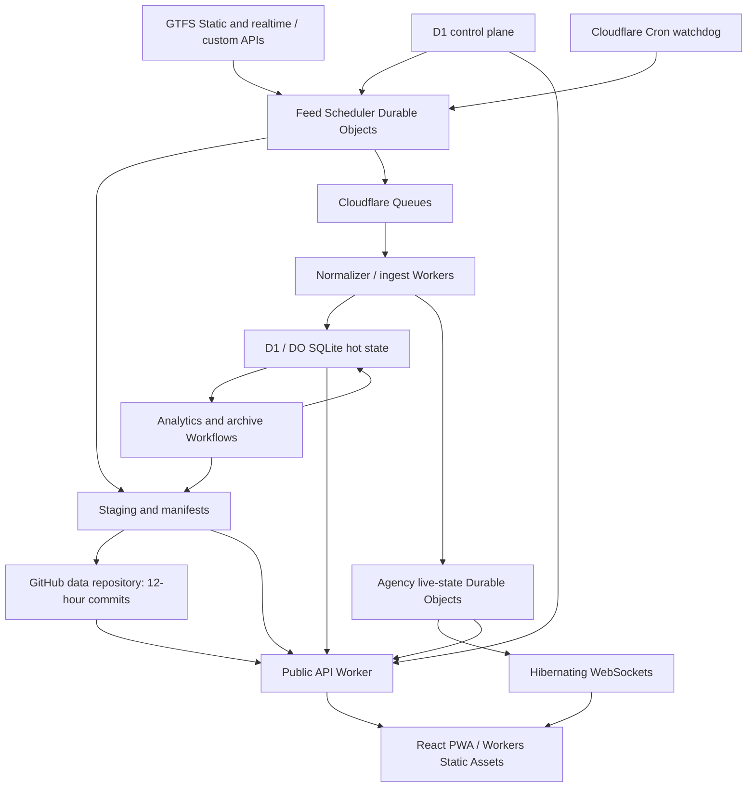

# Swisshost — Product Requirements Document

**Version:** 1.4 | **Date:** 2026-11-24 | **Status:** Proposed implementation specification

**Product:** A production-grade, map-first public transit tracking and intelligence platform, delivered as a responsive web application and installable PWA. Working name: Swisshost.

## 1. Vision and scope

Build an alternative to TransSee that preserves its depth of vehicle tracking, fleet discovery, historical movements and arrival information while replacing its navigation and presentation with a coherent modern interface. Think a straightforward, searchable transit reference website with an interactive live map, rather than a journey planner or operations dashboard. The application is useful to enthusiasts, riders, researchers and transit operations analysts.

This document specifies the complete intended product, not an MVP. All requirements marked SHALL are part of the production scope, subject to actual data availability and legal permissions. Implementation order is determined by dependencies, not by cutting product features. Coverage expansion is ongoing; completion does not mean integrating every transit agency in existence.

### Goals

- Explore live and historical transit activity with minimal clicks, on desktop and mobile.
- Track individual vehicles, routes, stops, trips, blocks and service patterns as first-class entities.
- Collect and retain observations independently of whether users are online.
- Support standard GTFS feeds and documented proprietary APIs through interchangeable adapters.
- Distinguish reported, scheduled, calculated and unknown information everywhere.
- Host as much as practical on Cloudflare; use only ongoing free services, with a strict $0/month operating budget. No paid plans, trials, or automatic upgrades.
- Provide public, shareable data views and documented machine-readable interfaces.

### Non-goals

Door-to-door journey planning, payment, dispatch/control of vehicles, native mobile apps, collection of passenger identities, or bypassing agency access controls. No implied partnership with agencies. No promise of historical data from before collection started unless a licensed backfill exists.

## 2. Users and key journeys

| Persona | Primary job |
|---|---|
| Rider | Find a stop, see approaching vehicles and trustworthy departure times |
| Enthusiast | Find a fleet number, inspect assignments, replay a vehicle's day, discover a rare vehicle |
| Researcher | Compare observed service with schedules; export reproducible data |
| Operations analyst | Identify gaps, bunching, late trips and data coverage problems |
| Administrator | Onboard agencies, manage feeds, monitor outages and correct metadata |

A rider can open a shared stop link, see upcoming departures and select an approaching vehicle. An enthusiast can search a fleet number, inspect its history, switch dates and replay movement without losing the map context. A researcher can select a route and date range, inspect coverage and export the underlying observations. An administrator can register a permitted feed, preview validation results, activate it and monitor its health without deploying a new frontend.

## 3. Experience and design system

### 3.1 Navigation and layout — simplicity is mandatory

Swisshost SHALL be a transit information website, not a SaaS dashboard. The same interface serves casual riders and power users. Advanced capabilities remain fully available through ordinary pages, contextual controls and direct links; there is no separate expert mode.

- Use a compact horizontal header with the Swisshost wordmark, agency selector, global search and a small settings control. Primary navigation is limited to **Map, Routes, Vehicles, Stops, History**. Trips and blocks are reachable from entity pages and search; alerts from affected entities and an agency alerts link; favorites from the header; analytics from relevant entity pages; feed status from the footer or agency information. Keep admin tools behind a separate authorized route.
- Use a single main content column with a sensible maximum width for text and tables; allow the live map and wide data tables to use the available width. No permanent navigation rail, dashboard grid or permanent secondary panel. Selecting a map marker opens a compact anchored popup or information section beneath the map; mobile may use a dismissible bottom sheet only for map selection.
- Desktop and mobile share the same information architecture. The header can wrap or use a compact overflow menu on narrow screens; do not introduce a different bottom navigation system. Avoid horizontal page overflow; wide tables may scroll inside their own labeled container, with key identifying columns kept visible where practical.
- Browser back/forward restores selections, dates and filters. Every entity has a stable, shareable URL. Global search covers routes, stops, vehicles, trips and blocks, supports agency scope, and offers keyboard access without requiring a shortcut or command palette.
- Use neutral backgrounds, a single sans-serif type family (system font stack is sufficient), clear hierarchy, modest spacing, subtle borders and route colors with accessible contrast. Support light, dark and system themes. Prefer text links, native controls, readable tables and plain status text over decorative cards, oversized buttons, icon-only actions and repeated badges.
- Put the most useful facts first. Secondary technical fields, raw feed identifiers and advanced filters use clearly labeled expandable sections; preserve deep links and allow direct access without opening multiple layers. No hover-only information or essential controls hidden behind unexplained icons.
- No decorative KPI cards, dashboard-first landing page, intrusive ads, ornamental animation or modal-heavy workflows. Charts appear only when they convey information better than a table. Analytics remain fully implemented but are contextual to routes, stops, trips and historical comparisons; no global KPI dashboard is required.

#### Brand palette — red and gold

Swisshost SHALL use the supplied red-and-yellow reference artwork as its color inspiration. The artwork's dominant colors are pure red (`#FF0000`), bright yellow (`#FFFF00`), black and white. Use a restrained red-and-gold identity, with accessible darker variants for functional UI; do not recolor the entire map or add decorative branding panels.

| Design token | Light theme | Dark theme | Role |
|---|---|---|---|
| Brand red (artwork) | `#FF0000` | `#FF0000` | Wordmark accent and small decorative brand details |
| Brand gold (artwork) | `#FFFF00` | `#FFFF00` | Small highlights, paired with dark text where applicable |
| Primary action / link | `#B91C1C` | `#FF8585` | Links, selected navigation and primary actions |
| Gold accent / focus | `#8A5A00` | `#FACC15` | Focus indicators and selective emphasis |
| Gold highlight surface | `#FFF4C2` | `#3A2D08` | Optional subtle selection background |
| Page background | `#FFFFFF` | `#121212` | Neutral canvas |
| Secondary surface | `#F7F7F7` | `#1C1C1C` | Tables, controls and map popups |
| Main text | `#181818` | `#F5F5F5` | Readable information |
| Secondary text | `#595959` | `#B5B5B5` | Metadata and timestamps |
| Subtle border | `#D4D4D4` | `#404040` | Separators and nonessential boundaries |

- Use red sparingly for the wordmark, active navigation underline, links and primary actions. Gold is a secondary accent, not a competing primary action color. Keep most of the interface neutral, with no gradients or large saturated backgrounds.
- Use semantic theme tokens rather than hardcoded component colors. Validate actual foreground/background combinations against WCAG 2.2 AA (4.5:1 for normal text, 3:1 for large text and applicable UI indicators). Use dark text on bright gold; do not use pure yellow text on white or assume white text on pure red passes. Ensure focus outlines contrast with adjacent surfaces.
- Agency route colors remain independent from Swisshost branding. Operational statuses (late, early, on time, stale, unavailable) use explicit text and, where needed, semantic colors distinct from branding; never rely on color alone.
- Preserve the same compact navigation, tables and entity pages in both themes. Apply branding to the PWA manifest, favicon and install icons consistently; the supplied artwork is color inspiration, not a mandatory logo asset.
- Keep all visual assets and theme implementation free of paid dependencies.

#### Page templates

| Page | Default content | Additional information |
|---|---|---|
| Live map | Agency, freshness, route filter, map, active vehicle count | Selected vehicle summary with links to vehicle, trip and history; advanced map filters |
| Routes | Searchable route list with number and name | Route map, directions, stops, timetable, active vehicles, alerts, contextual performance |
| Vehicles | Compact searchable and sortable fleet table | Vehicle overview, assignment history, map trace, fleet metadata and raw identifiers |
| Stops | Searchable stop list | Departures first, then map, routes, alerts and historical arrivals |
| History | Agency/entity and date selection, results table | Map replay, comparison, coverage, advanced filters and CSV export |
| Trip / block | Service date, identity, ordered schedule and observed times | Assignment transitions, layovers and technical identifiers |
| Admin / status | Feed list, freshness, errors and quota information in tables | Explicit management actions, audit log and diagnostic details |

#### Interaction requirements

The normal journey from a map marker to its vehicle page is one explicit link after selection. A vehicle page exposes history and current trip directly; a route page exposes its stops and vehicles directly. Entity pages use simple text tabs only when necessary (for example Overview, History, Fleet info). Search and filtering shall update results without a full page reload, preserve focus, and provide clear empty/loading/error states. Keep sort controls on table headers and advanced filters behind a single labeled disclosure. Provide direct CSV export from historical tables. Do not require accounts for public data exploration.

### 3.2 Map behavior

- Pan, zoom, rotate/reset, fit route/agency, optional locate-me and follow-selected-vehicle controls.
- Toggle routes, stops, vehicles, alerts, historical traces and optional rail layers; cluster or aggregate at low zoom, with accessible list alternative.
- Filter by route, branch, direction, vehicle type, fleet number, delay, age and assignment status; filters persist during entity navigation.
- WebGL layers, not one DOM element per vehicle. Optionally interpolate between actual observations only when useful for tracking; honor reduced-motion preferences; freeze or visibly mark stale positions rather than extrapolating indefinitely. Raw reported position remains inspectable.
- Maintain selection across updates and reconnections. Never move the user's viewport automatically unless follow mode is active.
- Attribution visible for map and agency data. Use a licensed vector basemap, not unrestricted bulk requests to public OpenStreetMap tile servers.

### 3.3 PWA and accessibility

Installable manifest, icons, service worker, offline shell, recently viewed static route/stop data, cached favorites and last-known data clearly labeled with timestamp. No claim that tracking works offline. Network-first for live information; versioned cache-first for immutable assets. Do not cache authenticated responses or precise user location. Support keyboard navigation, focus restoration, screen readers, reduced motion, touch targets and WCAG 2.2 AA. Test iOS Safari, Android Chrome and desktop evergreen browsers. Push notifications require supported browser/device and explicit opt-in; provide in-app alternatives.

## 4. Functional requirements

| ID | Capability | Acceptance outcome |
|---|---|---|
| F01 | Agency directory | Browse/search agencies by region, mode and capabilities; switch without reload; show source and feed status |
| F02 | Live map | Show available current positions, filters, route overlays and age; recover after disconnect without duplicate markers |
| F03 | Route explorer | Route variants, directions, shapes, stops, service calendar, scheduled trips, assigned vehicles, predictions, alerts and performance |
| F04 | Stop explorer | Stop code/name, platforms, parent station, routes, scheduled and predicted departures, approaching vehicles and observed history |
| F05 | Vehicle explorer | Search fleet numbers/aliases; current assignment, position, heading, speed, delay, last observation, previous assignments and historical trace |
| F06 | Trip and block explorer | Service-date-specific trip, stop sequence, schedule versus observations, vehicle assignment, block itinerary where available |
| F07 | Fleet registry | Known and observed vehicles, manufacturer/model/year/propulsion/accessibility/garage when sourced; aliases, provenance, correction workflow |
| F08 | Historical tracking | Date/range selection, route/vehicle/stop queries, timeline replay, speed chart, assignment changes, gap indicators and export |
| F09 | Analytics | Route/stop/trip performance, adherence, headways, bunching, travel/dwell times, observed trip completion, coverage and comparison views |
| F10 | Arrival prediction | Agency predictions, schedule fallback, independently computed predictions with accuracy/confidence metadata |
| F11 | Service alerts | Active and historical alerts, affected entities, validity windows and source links |
| F12 | Favorites and notifications | Local favorites without login; optional cross-device sync, saved filters, opt-in vehicle/route/stop/alert subscriptions |
| F13 | Public API and exports | Versioned API, pagination, rate limits, CSV/GeoJSON exports and documented data licensing |
| F14 | Feed operations | Admin onboarding, health, source validation, backfill/reprocessing, quarantine, status page and audit trail |
| F15 | Multi-agency display | Overlay selected agencies; namespace every identifier and respect each agency's timezone, permissions and capabilities |

### 4.1 Entity details

Vehicle page: agency and fleet ID, feed ID (if different), vehicle type, route/destination, trip and block, bearing, speed and units, schedule deviation, GPS age, next stops, today’s assignments, history, metadata sources and optional licensed photos. Unknown fields stay unknown; do not infer a manufacturer's model from a fleet number alone. A vehicle ID may be recycled or unstable; allow time-bounded aliases and avoid merging records without evidence.

Route page: short/long name, type, variants and branches, direction selector (do not assume 0/1 means north/south), route shapes, stop list, timetable, active trips, vehicles, alerts and analytics. Show estimated geometry if static shapes are missing, and label it.

Stop page: location, platform, stop code, accessibility when supplied, routes, upcoming departures with original schedule and predicted time, cancellation/skipped-stop indication, current and historical alerts, observed arrival history and nearby stops. Separate arrivals and departures if the source supports both.

Trip/block page: scheduled versus observed stop timeline, service date, trip instance identifier, route/shape version, trip status, vehicle history, layovers and assignment transitions. Do not assume a missing vehicle means a cancelled trip or that a block ID represents a stable fleet assignment.

### 4.2 Historical experience

Replay a vehicle, route or selected fleet over a chosen time range with play/pause, scrubber, speed controls (1x, 5x, 20x, 60x), timestamp, trail and observation-gap markers. Support comparison of multiple vehicles and shareable date/range URLs. Show actual observations on demand, not merely animated positions. Export filtered records asynchronously for large ranges; stream or page small ranges. Provide clear earliest available date, local timezone, missing periods and archive coverage. Query old data using retained schedule versions, not today's timetable.

### 4.3 Notifications

Subscriptions: selected vehicle enters service/route, stop departure threshold, service alert, optionally sustained route disruption. Evaluate server-side, deduplicate, apply cooldowns/quiet hours and expire obsolete events. Never promise exact arrival notification delivery. Account optional; anonymous local preferences remain usable. Authenticated subscriptions require opt-in, unsubscribe, deletion and delivery status. Do not send a notification based solely on an expired or missing feed.

## 5. Cloudflare-first architecture

Default deployment is Cloudflare Workers Free with Static Assets, SQLite-backed Durable Objects, D1, KV, Queues and Workflows where their ongoing free allowances apply. Use the free workers.dev hostname; no domain purchase. Use a dedicated ordinary GitHub Git repository, `swisshost-data`, as the durable historical archive, with commits every 12 hours. D1 and SQLite-backed Durable Objects provide bounded staging, static indexes and live state. No PostgreSQL, Hyperdrive, R2 or GitHub Releases. All features remain required; coverage, retention, refresh rates and concurrency are explicitly capacity-limited. No paid fallback may activate automatically.



### 5.1 Stack decisions

| Layer | Technology | Rationale |
|---|---|---|
| Web | React, TypeScript, Vite, React Router, TanStack Query | Simple entity-page SPA with live map, no unnecessary SSR framework runtime |
| UI | Tailwind CSS, shadcn/ui, accessible Radix primitives | Minimal accessible primitives; prefer native controls and tables |
| Maps | MapLibre GL JS, PMTiles/vector tiles | WebGL layers, open map ecosystem |
| Charts | Apache ECharts or Recharts (choose one during implementation) | Time-series and comparative visualization |
| PWA | Service worker / Workbox, web manifest | Install and controlled caching |
| API | Hono on Cloudflare Workers, Zod validation, OpenAPI | Lightweight Web-standard APIs |
| Scheduling | SQLite-backed Durable Object per logical feed | Durable sub-minute polling and single-owner scheduling |
| Watchdog | Cloudflare Cron Triggers | Recover stuck/missing feed alarms; periodic reconciliation |
| Ingestion | Workers + Queues + DLQ | Independent retries and throughput control |
| Live state | Sharded Durable Objects, WebSocket hibernation | Sequenced deltas and low-idle-cost fanout |
| Control plane | D1 | Agency catalog, feed configuration, permissions, user settings and audit metadata |
| Historical data | Ordinary GitHub repository + compressed CSV | Immutable time-window files, browser-side queries and precomputed summaries |
| Archives | GitHub Git commits every 12 hours | D1/DO staging until verified remote commit; no Releases |
| Cache | Cloudflare CDN/Cache API; KV for read-mostly metadata | No KV dependency for strong consistency or current vehicle state |
| Batch jobs | Cloudflare Workflows | Durable multi-step static imports, exports and aggregations |
| Heavy compute | Local operator CLI / free GitHub Actions within included quota | Chunked static imports, map preparation, archive verification; no paid containers or batch services |
| Auth | Free OIDC provider within ongoing quota or reviewed WebAuthn implementation; Cloudflare Access Free for admin | No custom password storage; separate admin authorization |
| Security | Free Cloudflare security features, application-level rate limiting, Turnstile Free | Abuse mitigation |
| CI/CD | GitHub Actions, Wrangler, infrastructure as code | Repeatable deployment and rollback |

Prefer Workers Static Assets over a separate Pages deployment for the unified web/API origin. SPA fallback applies only to UI routes, never to API errors. Generate lightweight public metadata pages for share previews if needed. Do not introduce Redis by default.

### 5.2 Service boundaries

- **web-api:** public assets, routes, API, authentication and query orchestration.
- **collector:** scheduled handler, feed scheduler DO, source fetching and durable archive manifests.
- **processor:** queue consumer, adapter normalization, transactional upserts, retry/DLQ handling.
- **live:** live-state and subscriber DOs, versioned snapshot/delta protocol.
- **jobs:** Workflows for static imports, reports, aggregation, retention, archive repair and exports.
- **admin:** protected management endpoints and feed diagnostics; Access plus app-level roles.

These may share one repository and deploy independently. Use service bindings for internal calls, not publicly exposed ingestion endpoints. Pin compatibility dates and test actual Workers runtime rather than assuming full Node.js compatibility.

## 6. Feed integration and ingestion

### 6.1 Agency model and onboarding

Distinguish dataset/feed, agency/operator and region: one GTFS dataset can describe multiple operators, and an operator can expose multiple feeds. Every source has documented ownership, URL, auth secret reference, adapter, permissions, timezone, polling policy, capabilities and health. Use a stable internal ID distinct from upstream names. Configuration changes are validated, versioned and auditable.

Initial complete integration set: Guelph Transit, TTC, Grand River Transit, GO Transit, MiWay and Brampton Transit, conditional on permitted sources and actual capabilities. Include static schedules when available; do not claim live support without verified positions. Use Mobility Database and Transitland for discovery, then verify official URLs, licenses, credentials, quotas and redistribution/retention permissions. Generic adapters must allow new compatible feeds without changing UI code. Unsupported/custom integrations require documented access and tests.

```yaml
# Illustrative, not a verified live URL
id: guelph
name: Guelph Transit
timezone: America/Toronto
feeds:
  - id: guelph-static
    adapter: gtfs-static
    url: ${GUELPH_STATIC_URL}
    refresh_seconds: 86400
  - id: guelph-positions
    adapter: gtfs-rt
    kind: vehicle_positions
    url: ${GUELPH_POSITIONS_URL}
    refresh_seconds: 30
    auth_secret_ref: null
    archive_policy: permitted
```

### 6.2 Static GTFS

Support required core files and optional shapes, frequencies, transfers, pathways, levels, translations, feed_info and accessibility attributes. Parse ZIP/CSV with correct quoting, UTF-8/BOM, optional values and size bounds. Validate references, coordinates, stop sequences, route types, dates and duplicate IDs. Stage an import, produce diagnostics, build indexes, activate atomically and retain previous versions. A failed import never replaces a valid active version. Use content hash plus HTTP validators to avoid repeated import. Handle feed validity windows, calendar exceptions, after-midnight times (e.g. 25:15), service-date-local time, daylight saving and frequency-based trips. Do not materialize an infinite timetable.

### 6.3 Realtime and custom adapters

Support GTFS-RT protobuf VehiclePositions, TripUpdates and Alerts, including feed header timestamps, trip schedule relationships, cancellations, added/duplicated trips where resolvable, stop updates and missing fields. Support documented JSON/XML and NextBus/Umo-style sources. Respect FULL_DATASET versus DIFFERENTIAL semantics; do not infer deletion from a partial or malformed feed. Where a differential implementation cannot be interpreted reliably, mark unsupported rather than silently corrupting state.

```ts
interface FeedAdapter {
  fetch(context: FetchContext): Promise<RawFeedResult>;
  normalize(raw: RawFeedResult, context: NormalizeContext): Promise<NormalizedBatch>;
  validate(batch: NormalizedBatch): ValidationResult;
}
interface Observation {
  sourceId: string;
  agencyId: string;
  sourceVehicleId: string;
  vehicleId: string | null;
  tripInstanceId: string | null;
  routeId: string | null;
  lat: number; lon: number;
  bearingDeg: number | null;
  speedMps: number | null;
  observedAt: string | null;
  receivedAt: string;
  timestampBasis: 'vehicle' | 'feed' | 'receipt';
  rawRef: string;
}
```

Canonical normalized batches also include trip updates, alerts, source timestamps, coverage mode, quality flags and adapter version. Preserve raw source identifiers and provenance. Normalize SI units; format user-facing units according to locale. No assumption that speed/bearing/occupancy is present or reliable. Never label derived speed or inferred assignment as agency-reported.

### 6.4 Durable polling and reliability

Use one scheduler DO per upstream logical feed (not per user or vehicle). Configure 15–60 second live intervals subject to provider permission and actual feed refresh rate. Cron is a watchdog, not the primary sub-minute scheduler. DO alarms are not a real-time guarantee; record lateness, use deterministic jitter, and skip missed ticks rather than hammering upstream. Persist next due time and poll generation; ensure no overlapping fetch for a feed. Reschedule safely even on failure; watchdog repairs missed scheduling. Enforce deadlines, byte caps, conditional requests, Retry-After, bounded exponential backoff and per-provider rate budgets. Static imports usually check daily and on demand.

Pipeline: fetch -> validate transport -> write permitted raw object or durable normalized source batch to the bounded archive store -> persist manifest -> enqueue reference -> normalize -> idempotent database transaction -> publish live change -> aggregate later. Use deterministic batch IDs and reconciliation to repair the archive/queue/database non-atomic boundary. Queue delivery is at least once; deduplicate retries. A failed batch goes to DLQ after bounded attempts and can be replayed. Store only small references in queue messages. Large feeds must use bounded chunks; do not load large ZIPs into a Worker isolate without memory testing. Do not archive data prohibited by source terms.

Record both receipt and observation time, reject impossible coordinates, quarantine corrupted batches, flag improbable speed/jumps and handle out-of-order data. Preserve valid late observations in history without replacing newer live state. Deduplicate repeated observations while retaining legitimate stationary samples with new timestamps. Missing timestamps get an explicit receipt-time fallback flag. Live status distinguishes fresh, delayed, stale, unavailable and unknown. Default stale threshold 90 seconds, configurable by source cadence; no phantom continuity across outages.

## 7. Data model and retention

Use UUID/internal IDs plus source identifiers. All entity queries scoped by source/agency and version where relevant. UTC instants for observations, local service date plus scheduled seconds after midnight for timetable. Record timezone explicitly.

| Store/table | Key and purpose |
|---|---|
| D1 agencies, sources, capabilities | Stable IDs, source policy, activation and configuration history |
| D1 users, favorites, subscriptions, audit | Minimal account state and admin actions; secrets in secret bindings |
| D1/DO or archived feed_versions | source_id + content_hash, validity, raw reference |
| D1/DO or archived routes, stops, shapes, trips, stop_times, calendars | Versioned static entities and spatial geometry |
| D1/DO or archived trip_instances | source/version + trip ID + service date + start time/discriminator |
| D1/DO or archived vehicles, vehicle_aliases, fleet_metadata | Stable identities, time-bounded aliases, sourced attributes |
| D1/DO or archived vehicle_observations | Partition time + source + deterministic observation key; GPS and provenance |
| D1/DO or archived vehicle_latest | Current state per source vehicle, conditional timestamp update |
| D1/DO or archived vehicle_assignments | Vehicle-to-trip/route intervals and confidence |
| D1/DO or archived trip_updates, alerts | Current and historical updates where permitted |
| D1/DO or archived stop_events | Arrival/departure estimates, bounds, source, quality and schedule comparison |
| D1/DO or archived route_metrics, segment_metrics, headway_metrics | Materialized time-bucketed aggregates and coverage |
| D1/DO or archived ingest_batches, publication_outbox | Idempotency, processing state and durable publication reconciliation |
| GitHub repository and D1/DO staging | Versioned object keys, hashes, schema version and manifests |
| DO live snapshots and sequences | Rebuildable current state and subscription cursors |

Use bounded SQLite indexes for recent queries, spatial bounding boxes and precomputed shape progression. Store historical observations and derived records as immutable compressed CSV files; use browser-side DuckDB-Wasm or bounded streaming queries and precomputed summaries. Preserve schedule versions. Do not insert one D1 row per GPS point if batched chunks meet query requirements.

### 7.1 Git repository archive and 12-hour backups

The dedicated `swisshost-data` repository is a normal Git repository, not Releases or LFS. Use a private repository by default; expose only licensed data through the Worker API. Public distribution requires explicit approval. Never commit credentials, user settings, personal information or restricted source data.

```text
swisshost-data/
  agencies/<agency>/config.json
  agencies/<agency>/fleet.csv
  schedules/<agency>/<feed-hash>.zip
  history/<agency>/YYYY/MM/DD/00-12/positions.csv.gz
  history/<agency>/YYYY/MM/DD/12-24/positions.csv.gz
  history/<agency>/YYYY/MM/DD/<window>/stop-events.csv.gz
  history/<agency>/YYYY/MM/DD/<window>/assignments.csv.gz
  history/<agency>/YYYY/MM/DD/<window>/metrics.json
  manifests/<agency>/YYYY/MM/DD/<window>.json
```

- Collect continuously at permitted cadence; backup at 00:00 and 12:00 UTC using Cloudflare Cron (`0 0,12 * * *`). Do not poll agency feeds only twice daily.
- Seal completed windows, produce deterministic compressed files (split into small immutable parts as needed), and create manifests with schema version, time bounds, row counts, SHA-256 and schedule references.
- Publish using a scoped GitHub App or fine-grained token stored as a Worker secret. Create blobs, tree and commit via GitHub Git Data API, then update the branch without force. Serialize writers, retry conflicts with bounded backoff, and checkpoint large jobs. Never rewrite an accumulating CSV or force-push history.
- Confirm the remote commit and verify manifest/file integrity before marking the window backed up or purging staging. Late observations use immutable supplemental parts. Retry failed backups from retained staging; alert on missed windows and pause collection before staging exhaustion.
- Historical reads use indexed manifests and immutable commit references; cache permitted responses and fetch only relevant time/agency chunks. Restore from a clean clone and validate checksums, schema versions and coverage. Maintain optional independent local clones for disaster recovery.
- GitHub is not an unlimited database. Track repository size, API usage and clone performance; set conservative admission limits, rotate to yearly/agency-specific ordinary repositories when justified and permitted, and pause expansion if free capacity or platform policies are reached. Do not use rotation to evade provider restrictions. Keep individual files well below GitHub's file limits. No guarantee of indefinite hosted retention.
- Remote backup recovery point target: 12 hours during normal operation, potentially longer during outages; local staging may contain newer data. Never claim zero data loss. Preserve full product functionality within measured free capacity.

## 8. Real-time delivery and API

Use WebSocket hibernation in DOs for public live subscriptions. Partition by agency and shard further by deterministic route/vehicle buckets or subscriber groups when load tests require. Authoritative latest state remains recoverable from PG; DO snapshots are derived. Clients fetch snapshot + cursor, subscribe to deltas, detect gaps, reconnect with backoff and resnapshot if cursor expired. Subscribe only to useful agencies/filters; coalesce high-frequency updates. Bound outbound buffers and disconnect slow clients. Provide polling fallback. Include heartbeat, freshness and status events. Avoid one upstream request per browser.

Public API prefix `/api/v1`, JSON by default, GeoJSON for map features, OpenAPI specification and generated typed client. Stable opaque cursors, bounded ranges/limits, explicit timezone and observation quality, request IDs, ETags/cache headers appropriate to freshness. Historical exports are jobs with expiring authorized download links. Return consistent problem-details errors (400/404/409/429/503). Public endpoints never expose upstream keys or unlicensed raw feeds.

| Method/path (agency prefix omitted) | Purpose |
|---|---|
| GET /agencies | Directory and capability flags |
| GET /agencies/:id/status | Feed freshness and coverage |
| GET /agencies/:id/vehicles | Live snapshot with route/bbox filters |
| GET /agencies/:id/vehicles/:vehicle | Vehicle details and metadata |
| GET /agencies/:id/vehicles/:vehicle/history | Observations and assignment intervals |
| GET /agencies/:id/routes | Routes, variants, shapes |
| GET /agencies/:id/routes/:route | Route detail, schedule, active service |
| GET /agencies/:id/stops | Spatial or text search |
| GET /agencies/:id/stops/:stop/arrivals | Scheduled, reported and inferred departures |
| GET /agencies/:id/stops/:stop/history | Observed stop events |
| GET /agencies/:id/trips/:instance | Service-date trip timeline |
| GET /agencies/:id/blocks/:block | Service-date block schedule and observations |
| GET /agencies/:id/alerts | Active/historical alerts |
| GET /agencies/:id/analytics/:metric | Time buckets, denominators, coverage |
| GET /search | Cross-entity, cross-agency search |
| GET /live | WebSocket upgrade with scoped subscriptions |
| POST /exports; GET /exports/:id | Async data export lifecycle |
| GET/PUT /me/favorites; /me/subscriptions | Authenticated preferences |
| /admin/* | Protected feed/fleet operations |

## 9. Transit intelligence and prediction

### 9.1 Trip matching and map matching

Prefer explicit valid trip descriptors; resolve service date/start time against the correct schedule version. For missing IDs use route/direction, candidate trips, spatial proximity to shape, heading, time window and prior assignment continuity. Use monotonic progress where appropriate; handle loops, branches, short turns, layovers, detours and deadheading. Store method, confidence and algorithm version. Low-confidence vehicles stay unassigned rather than being forced onto a route. Preserve raw GPS independent of snapped geometry.

### 9.2 Stop detection

Use reported stop sequence/status when valid, route progress and time-bounded proximity/dwell observations. Infer arrival/departure intervals between GPS samples, not exact second precision. Distinguish pass-through, dwell, skipped and unknown. Handle closely spaced stops, terminals and opposite directions. Validate against labeled samples and retain confidence/uncertainty. Do not count an unobserved trip as cancelled or a missing stop event as a skip.

### 9.3 Prediction hierarchy

Display agency-reported prediction when valid; separately offer internal estimate if sufficient evidence exists; otherwise show scheduled time or unknown. The internal model uses historical segment travel-time and dwell distributions, day type/time bucket, current progress and recent network conditions. Start with robust statistical estimators, shrink sparse samples toward broader route/segment averages, enforce plausible nonnegative times and monotonic stop order. Recompute on new observations. Output prediction timestamp, source, uncertainty and model version. Backtest against held-out service days without future leakage; compare MAE, median absolute error and percentile errors with schedule and agency prediction baselines where comparable. If quality/coverage is inadequate, suppress the model. Track drift and allow rollback. No ML infrastructure required merely to claim prediction support.

### 9.4 Analytics definitions

- Schedule adherence: observed arrival/departure minus scheduled counterpart; configurable early/late thresholds; denominator is matched observations, not all scheduled stops.
- Headway: elapsed time between comparable successive vehicles at the same reference stop/segment and direction; account for branches and scheduled frequency. Report bunching and gap thresholds with definitions.
- Travel time: elapsed time between matched segment observations, with percentile distributions and sample size.
- Dwell: inferred arrival-to-departure duration, uncertainty and observation cadence disclosed.
- Service delivered: observed trip evidence versus scheduled trips; label unmatched/unknown separately from explicitly cancelled service.
- Fleet utilization: observed active vehicles, assignments and inactive/unknown counts; not a claim of mechanical availability.
- Coverage: expected versus received feed intervals, fresh vehicles, matched trips, stop detection confidence and missing data windows.

Allow date range, day type, direction, branch, route, stop and hour filters; compare periods with equivalent service calendars; show timezone, units, sample counts, source coverage and algorithm version. Provide accessible charts and tables plus CSV exports. Precompute common hourly/daily aggregates; bound ad hoc queries and run expensive analyses asynchronously. Recompute affected buckets when late observations or algorithm versions change.

## 10. Production quality, security and operations

### 10.1 Targets

| Metric | Production target |
|---|---|
| Public application/API availability | best-effort (no paid SLA) monthly, excluding separately reported upstream availability |
| Initial useful UI | p75 LCP <= 2.5 s on representative mobile connection |
| Cached API | p95 <= 250 ms in target geography |
| Typical historical query | p95 <= 2 s for one vehicle/day, indexed hot history |
| Ingest latency | p95 <= 5 s from successful receipt to published live state under rated load |
| Freshness | Per-feed target; stale information explicitly identified |
| Map rendering | 1,000 visible moving markers on representative desktop; adaptive mobile rendering |
| Recovery | Remote archive RPO <= 12 hours during normal operation; RTO target <= 4 hours, validated by restore drills |
| Accessibility | WCAG 2.2 AA target, manual and automated testing |

These are engineering targets, not guaranteed provider SLAs. Measure separately for live UI, database, collector and upstream sources. Load test 10,000 simultaneously tracked vehicles and 1,000 concurrent live clients as a production capacity benchmark, with a documented path to higher limits. Define workload and test duration before claiming compliance.

### 10.2 Security and privacy

Apply least-privilege bindings, separate logical production/staging resources within shared free quotas, secret rotation, TLS, CSP, XSS/CSRF protections, parameterized SQL and authorization checks per object. Public endpoints are read-only except constrained account/export operations. Limit query ranges, export sizes, concurrency and connection counts. Restrict agency fetch URLs to reviewed HTTPS hosts, validate redirects and prohibit internal/private network destinations. Bound decompression and parsing to prevent ZIP bombs and XML entity attacks. Keep logs free of credentials, personal location and push endpoints. Use explicit consent for optional location and notifications; support account export/deletion and subscription revocation. Audit administrator changes. Document acceptable-use and data licenses. Never expose driver or passenger personal information.

### 10.3 Monitoring and failure recovery

Instrument per-source poll latency, error rates, last successful fetch, source timestamp, bytes, normalized observations, duplicate ratio, queue lag/DLQ, DB commit time, live publish lag, WebSocket count, prediction quality and archive verification. Use Cloudflare Workers logs/observability and sampled traces; export alerts to an operator channel. Public status page shows separate upstream and platform incidents. Alert on feed freshness, persistent missing alarms, queue backlog, DB saturation, failed backups and cost anomalies. Runbooks cover replay, rollback, credential expiration, invalid static imports, reconnect storms, failed deployment and database restoration. Test restoration periodically. Degrade gracefully: keep static schedules accessible during live outages; keep live service usable during analytics backlog where possible.

## 11. Free-only infrastructure, quotas and scaling

**Hard requirement: $0/month in service charges.** No paid subscriptions, metered overages, paid trials, purchased domains, paid APIs, paid email delivery, or paid compute. A free allowance on a billable product is not a hard spending cap. Prefer services that reject requests when their free quota is exhausted. If a service cannot enforce zero spend, disable it in the hosted configuration. No automatic upgrades or quota circumvention through multiple accounts. Any future paid migration requires an explicit owner decision and PRD revision.

| Service | Free deployment policy |
|---|---|
| Workers + Static Assets | Workers Free; workers.dev hostname; cache immutable assets |
| Durable Objects | Free SQLite-backed namespaces, bounded alarms and hibernating WebSockets |
| D1 / KV | Free quotas; use D1 for control data and bounded archive chunks; minimize writes |
| Queues / Workflows / Cron | Only Free-plan entitlements; batch and checkpoint work; bounded retries |
| GitHub data repository | Free ordinary Git repository; 12-hour commits; bounded API and repository usage |
| R2 / external databases | Not used |
| Basemap | OpenStreetMap-derived regional vector data with proper attribution; free licensed hosted tiles within explicit limits or locally prepared regional PMTiles served from free static hosting where file limits permit; never bulk-download public OSM tiles |
| Authentication | Free OIDC or WebAuthn; no paid SMS/email; free admin Access or application authorization |
| Notifications | Standards-based Web Push with VAPID and in-app notifications; no paid messaging provider |
| Monitoring / CI | Included free logs, local tests and GitHub Actions within ongoing free allowances; no paid telemetry |

### 11.1 Admission control and storage budgeting

Verify current provider quotas before deployment and record them in versioned configuration. Workers Free has strict CPU and request limits; design parsers and analytics as bounded, resumable jobs. Benchmark staging, GitHub archive commits and historical reads before activating each feed. Use spatial bounding boxes and precomputed shape progression. All feature interfaces must remain functional within free quotas.

Start with one small agency (Guelph), initially polling permitted live feeds at 60 seconds and adapting to measured freshness and capacity. For illustration, 50 active vehicles for 16 hours/day at 60-second cadence yield up to 48,000 observations/day, or 1.44 million per 30-day month before deduplication. At 150 bytes/observation that is 216 MB/month before indexes and overhead. Three feeds at 60 seconds generate 4,320 polls/day; downstream requests, alarms, writes and retries are additional. Batch compressed observations by agency/time window rather than one archive object or row per point where practical. Measure actual storage and compute consumption.

At 70% of any quota, warn and restrict costly exports/backfills; at 85%, slow nonessential polling and reduce public query concurrency; at 95%, pause affected collection or operations before the quota is exhausted, reserving capacity for state persistence and recovery. Enforce atomic quota reservations for concurrent operations and account for retries, indexes, staging and backups. Provider quotas are the final guardrail, not billing alerts. On exhaustion, show explicit coverage gaps, stale status and retry/reset information; do not fabricate updates. Use local exports to retain additional history outside hosted quotas, subject to licensing. An operator must approve each additional agency after a representative workload test demonstrates headroom across all services.

### 11.2 Full feature scope versus capacity

This is not an MVP: all features F01–F15, including historical replay, predictions, analytics, accounts, notifications, exports and administration, must be implemented. Free hosting cannot guarantee unlimited agencies, indefinite GPS retention, high traffic or a paid SLA. Limit workload rather than removing product features. Publish observed capacity, actual retention, feed coverage and best-effort availability. Future scaling must remain a configuration/adapter change where practical, but paid infrastructure is outside the current deployment authorization.

## 12. Repository and deployment

```text
swisshost/
  apps/
    web/                 # React/Vite PWA
    api/                 # Hono public API Worker
    collector/           # scheduler DOs and source fetch
    processor/           # queues, normalize, persist
    live/                # state and subscriber DOs
    jobs/                # Workflows and exports
    admin/               # operations UI/API
  packages/
    adapters/            # GTFS, GTFS-RT, custom
    contracts/           # shared schema and API types
    database/            # D1 and DO SQLite migrations
    transit-core/        # service dates, identity, matching
    analytics/          # events, aggregation and prediction
    ui/                 # shared components
    test-fixtures/       # licensed/synthetic feed samples
  config/agencies/
  infra/                 # Wrangler and provision scripts/IaC
  docs/                  # architecture decisions, API, runbooks
  .github/workflows/
  PRD.md
```

Use pnpm workspaces and strict TypeScript. Each Worker gets explicit bindings, compatibility date, CPU budget and environment configuration. Use reproducible lockfiles and CI: lint, typecheck, unit tests, migration validation, Worker integration tests, browser tests, security/dependency scans, staging deployment and smoke test before production approval. Use local staging by default; hosted staging must share the same free-quota budget. Use forward-compatible database migrations, expand/contract schema changes and backward-compatible queued messages. Deploy static assets and API contracts compatibly; maintain rollback instructions including DO migrations. Seed only synthetic or explicitly licensed fixtures. Developer setup includes documented commands, Wrangler local simulation, local SQLite/D1 simulation and replay of sample feeds.

## 13. Implementation sequence — full product, no MVP gate

All workstreams below are required. Start continuous permitted collection as soon as infrastructure is ready because missed historical observations cannot be recovered. Internal integration checkpoints are not public product releases or permission to omit later capabilities.

| Workstream | Deliverables | Depends on |
|---|---|---|
| A. Foundation | Repo, Cloudflare resources, schema, CI, secrets, licensing registry, observability | None |
| B. Collection | Static imports, RT adapters, DO alarms, watchdog, queue/DLQ, archive, identity, health | A |
| C. Experience | Minimal shared page templates, horizontal navigation, responsive map, agency switching, search, all entity pages, PWA | A, B contracts |
| D. History | Assignment history, map replay, archive retrieval, exports, fleet registry | B, C |
| E. Intelligence | Matching, stop events, adherence, headways, prediction model and validation | B, D and adequate observations |
| F. Personalization | Favorites, optional accounts, subscriptions and push | C, E events |
| G. Coverage | Initial six agency integrations, custom adapters, data policies and status | B |
| H. Production hardening | Security, accessibility, load tests, restore drills, documentation, operational acceptance | A–G |

Historical analytics must show insufficient sample sizes until data accumulates. The product can be feature-complete without pretending to have years of history on launch. Do not create synthetic records in production to make charts look populated.

## 14. Definition of done and verification

- [ ] All F01–F15 capabilities implemented end to end, with unavailable-source states explicitly supported.
- [ ] All initial agencies evaluated, permitted adapters implemented and tested; activate only agencies that fit the free quota budget; generic onboarding proven on an additional standard feed.
- [ ] Static version activation/rollback and historical schedule matching verified across midnight, DST, exceptions, frequency trips and service changes.
- [ ] Feed retries, duplicates, out-of-order data, differential updates, partial outages and invalid records tested with replayable fixtures.
- [ ] Collector runs without web traffic; alarms recover through watchdog; queue DLQ replay and outbox reconciliation preserve idempotency.
- [ ] Live snapshot/delta reconnect, stale markers and polling fallback verified across desktop/mobile and network interruption.
- [ ] Every entity has a deep link; navigation, filters, search and browser history work consistently.
- [ ] Public pages use the five-item primary navigation and shared desktop/mobile information architecture; no persistent sidebars, decorative KPI grids or separate power-user mode.
- [ ] Map selection links directly to vehicle, trip and history; entity pages expose relevant related records, analytics and exports without dashboard detours.
- [ ] Usability tests cover finding a vehicle, checking a stop departure, viewing a vehicle's historical trace and exporting route history using the same simple interface.
- [ ] Advanced fields and filters are accessible through labeled contextual controls; tables remain readable and keyboard operable on narrow screens.
- [ ] Historical replay, Git archive retrieval, data export, fleet provenance and date-range coverage implemented and tested.
- [ ] Automated 12-hour Git commits, idempotent retries, checksum verification, missed-backup alerts and clean-clone restore tested.
- [ ] Analytics formulas verified against controlled fixtures; uncertainty and denominators visible; prediction backtest and fallback documented.
- [ ] Favorites, account sync, notification consent/unsubscribe and privacy/deletion tested.
- [ ] PWA install, offline shell and cache invalidation verified; no stale data mislabeled as live.
- [ ] Accessibility review, responsive/browser coverage and reduced-motion checks pass.
- [ ] Red-and-gold brand tokens are applied consistently across public pages and PWA assets; both themes pass contrast and focus checks, with route colors and status meanings preserved.
- [ ] Security review, abuse tests, SSRF protection, authorization and secret management pass.
- [ ] Production load benchmarks, backup restoration and failure drills meet free-capacity targets; deployment audit confirms $0 recurring charges, no enabled uncapped billable products, quota exhaustion tests and no automatic paid upgrades.
- [ ] Public API docs, source attribution, status page, runbooks and deployment instructions complete.
- [ ] No placeholder screens, fake live data, dead navigation or unimplemented production buttons.

## 15. Reference documentation

Architecture uses the following official references; review ongoing free entitlements and hard quota enforcement before deployment:

- [Cloudflare Workers Static Assets](https://developers.cloudflare.com/workers/static-assets/)
- [Cloudflare storage options](https://developers.cloudflare.com/workers/platform/storage-options/)
- [Durable Objects alarms](https://developers.cloudflare.com/durable-objects/api/alarms/)
- [Durable Objects limits](https://developers.cloudflare.com/durable-objects/platform/limits/)
- [Durable Objects WebSockets](https://developers.cloudflare.com/durable-objects/best-practices/websockets/)
- [Cloudflare Queues limits](https://developers.cloudflare.com/queues/platform/limits/)
- [Cloudflare Workflows](https://developers.cloudflare.com/workflows/)
- [Workers platform limits](https://developers.cloudflare.com/workers/platform/limits/)
- [Workers pricing](https://developers.cloudflare.com/workers/platform/pricing/)
- [GTFS specifications and best practices](https://gtfs.org/documentation/overview/)
- [Mobility Database](https://mobilitydatabase.org/)
- [Transitland](https://www.transit.land/)
- [MapLibre GL JS](https://maplibre.org/maplibre-gl-js/docs/)
- [Durable Objects pricing and free limits](https://developers.cloudflare.com/durable-objects/platform/pricing/)
- [Workflows pricing](https://developers.cloudflare.com/workflows/reference/pricing/)
- [D1 pricing](https://developers.cloudflare.com/d1/platform/pricing/)

## 16. Final product positioning

Swisshost is a public transit tracking and intelligence platform. The differentiator is not access to secret agency data: it is reliable long-running collection, normalized multi-agency information, honest handling of uncertainty, useful historical analysis and a modern interface that makes all of this easy to explore.
