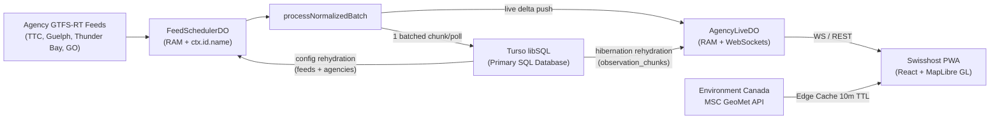

# Swisshost Architecture & Transit Models

This document describes Swisshost's Turso-first persistence architecture, the unified multi-agency live data pattern, the TTC Subway kinematic timing model, and the edge-cached Environment Canada weather integration.

---

## 1. Turso-First Database Architecture (Zero Cloudflare DO SQLite)

Swisshost runs its compute on **Cloudflare Workers** and its persistent SQL database on **Turso (libSQL)** via the Hrana v2 HTTP pipeline adapter ([packages/database/src/turso.ts](../packages/database/src/turso.ts)).



### Hard Persistence Rules
1. **Turso is the single source of truth for SQL state.** Every entrypoint wraps `env` with `withActiveDb(env)` ([apps/api/src/env.ts](../apps/api/src/env.ts)):
   - Worker HTTP requests (`fetch`)
   - Cloudflare Cron jobs (`scheduled`: watchdog & 12-hour archive)
   - `FeedSchedulerDO` constructor
   - `AgencyLiveDO` constructor
   When `TURSO_DATABASE_URL` and `TURSO_AUTH_TOKEN` secrets are bound, `env.DB` routes 100% of queries and batches to Turso over HTTP. Cloudflare D1 is never written to.
2. **Zero Cloudflare Durable Object SQLite storage writes.** Neither `AgencyLiveDO` nor `FeedSchedulerDO` calls `ctx.storage.sql`. Cloudflare's free DO SQLite tier has a strict daily row-write cap; keeping DO SQLite usage at zero prevents hibernation crashes and quota lockouts on high-volume agencies like TTC (~1,850 vehicles/min).
3. **Zero-storage DO identity (`this.ctx.id.name`).** Because every DO is addressed by deterministic name (`AGENCY_LIVE.getByName(agencyId)` and `FEED_SCHEDULER.getByName(feedId)`), waking DOs know their agency or feed ID directly from the Workers runtime and rehydrate from Turso in a single `SELECT`:
   - `AgencyLiveDO` hydrates recent live vehicles via `loadLatestLiveVehiclesFromTurso()` reading the latest `observation_chunks` rows from Turso.
   - `FeedSchedulerDO` hydrates its polling configuration via `loadFeedConfigFromTurso()` reading `feeds JOIN agencies` from Turso.
4. **Live verification.** `GET /api/v1/status` reports:
   ```json
   "database": {
     "provider": "turso",
     "doSqliteStorage": "disabled"
   }
   ```

---

## 2. Unified Multi-Agency Live Data Pattern

All configured Ontario agencies (`ttc`, `guelph`, `thunderbay`, `go`) follow the exact same pipeline:

| Stage | Shared Component | Agency Behavior |
|---|---|---|
| Config | `config/agencies/<id>.json` | Registered in `BUILTIN_AGENCIES` and seeded into Turso `agencies` & `feeds` |
| Static GTFS | `infra/seed-static.ts` / `importStaticGtfsForAgency` | Populates `routes`, `stops`, `trips`, `stop_times`, `calendars` in Turso |
| Live Polling | `FeedSchedulerDO` (`getByName(feedId)`) | Polls GTFS-RT (or Umo XML) on alarm; reloads config from Turso if hibernated |
| Processing | `processNormalizedBatch` | Updates `AgencyLiveDO` RAM, writes 1 compact tuple `observation_chunks` row to Turso, tracks fleet/assignment deltas |
| Live Fanout | `AgencyLiveDO` (`getByName(agencyId)`) | Streams WebSocket deltas to clients; rehydrates from Turso `observation_chunks` on wake |
| REST Fallback | `GET /api/v1/agencies/:id/vehicles` | Reads `AgencyLiveDO`, falls back to `loadLatestLiveVehiclesFromTurso()` if cold, enriches route/stop metadata, merges kinematic rail trains when a rail corridor has no live GPS |

### Adding a New Agency
1. Add `config/agencies/<agency>.json` with `id`, `modes`, `center`, `defaultZoom`, and `feeds`.
2. Register the config in `BUILTIN_AGENCIES` ([apps/api/src/env.ts](../apps/api/src/env.ts)) and add its display name in [apps/web/src/lib/agencies.ts](../apps/web/src/lib/agencies.ts).
3. If the agency covers a new Ontario city, add its verified ECCC `citypageweather-realtime` hub code to `ECCC_ONTARIO_HUBS` ([packages/transit-core/src/weather.ts](../packages/transit-core/src/weather.ts)).
4. Seed static GTFS into Turso with `npx tsx infra/seed-static.ts <agency>`.

Because all scheduling, chunk persistence, hibernation rehydration, and API fallbacks are agency-agnostic, new agencies inherit Turso persistence automatically.

---

## 3. TTC Subway & Rail Kinematic Timing Model

TTC's public GTFS-RT feed (`https://bustime.ttc.ca/gtfsrt/vehicles`) publishes live GPS for **buses and streetcars** (~1,800+ vehicles), but does **not** expose live train coordinates for underground subway lines (Lines 1, 2, and 4). Similarly, GO Rail trains await `GO_TRANSIT_API_KEY`.

Whenever a rail corridor has no live GPS reporting (and automatically yielding to live GPS the moment real vehicles appear on that route), Swisshost estimates train positions, instantaneous speeds, and upcoming station ETAs in [packages/transit-core/src/rail-networks.ts](../packages/transit-core/src/rail-networks.ts) using three coupled mathematical models:

### 3.1 Continuous Service-Day Headway Integration
Rather than multiplying by the current headway at the current minute (which causes trains to jump or vanish at rush-hour boundaries), departure times $t_k$ from each terminus are integrated continuously across the local `America/Toronto` service day:

$$t_0 = t_{\text{start}}(\text{day}) + \phi_{\text{dir}}, \qquad t_{k+1} = t_k + H(t_k, \text{day})$$

- **Day-of-week awareness:** TTC Subway starts at `06:00` (360 min) Monday to Saturday and `08:00` (480 min) on Sundays.
- **Period headways $H(t, \text{day})$:**
  - **Line 1 (ATC):** 2.5 min weekday rush (`07:00-09:30`, `15:30-18:45`), 4.0 min midday, 4.5 min evening/weekend, 5.5 min late night.
  - **Line 2 (Bloor-Danforth):** 3.0 min weekday rush, 4.5 min midday, 5.0 min evening/weekend, 6.0 min late night.
  - **Line 4 (Sheppard):** 5.5 min rush, 6.0 min midday/evening/weekend, 6.5 min late night.
- **Opposing-direction phase offset:** Direction 1 starts shifted by $\phi_1 = H(t_{\text{start}}) / 2$ so northbound/southbound or eastbound/westbound trains stagger naturally.

### 3.2 Station-Tiered Dwell Time
Each inter-station segment $[s_i, s_{i+1}]$ has scheduled duration $T_{\text{seg}} = (\text{offset}_{i+1} - \text{offset}_i) \times 60\text{ s}$. Dwell time $T_{\text{dwell}}$ at station $s_i$ increases at major transfer hubs (Union, Bloor-Yonge, St George, Spadina, Sheppard-Yonge, Eglinton, Finch, VMC, Kipling, Kennedy, Don Mills) and during peak hours:

$$T_{\text{dwell}} = \min\!\left(T_{\text{base}} + \Delta_{\text{hub,peak}},\; \lfloor 0.42 \cdot T_{\text{seg}} \rfloor\right)$$

While $0 \le t_{\text{seg}} \le T_{\text{dwell}}$, the train reports `STOPPED_AT` at station $s_i$ with speed `0 m/s`.

### 3.3 Trapezoidal Train Kinematics (Acceleration, Cruise, Braking)
For the remaining moving window $T_{\text{move}} = T_{\text{seg}} - T_{\text{dwell}}$, track arc distance is estimated from Haversine station spacing using a corridor curvature factor ($D = \kappa \cdot d_{\text{haversine}}$, with $\kappa \approx 1.08$ on Line 1).

Using Toronto Rocket / T1 fleet dynamics ($a = 1.1\text{ m/s}^2$ acceleration, $d = 1.2\text{ m/s}^2$ service braking, $v_{\max} = 22.2\text{ m/s} \approx 80\text{ km/h}$), let $\alpha = \frac{1}{a} + \frac{1}{d}$. The cruise velocity $v_c$ satisfies the exact trapezoidal area equation:

$$D = v_c T_{\text{move}} - \frac{1}{2}\alpha v_c^2 \quad\Longrightarrow\quad \frac{1}{2}\alpha v_c^2 - T_{\text{move}} v_c + D = 0$$

Taking the physically valid root clamped to $v_{\max}$:

$$v_c = \min\!\left(v_{\max},\; \frac{T_{\text{move}} - \sqrt{T_{\text{move}}^2 - 2\alpha D}}{\alpha}\right)$$

(If $T_{\text{move}}^2 < 2\alpha D$, the solver smoothly falls back to a triangular accelerate/brake profile with $v_{\text{peak}} = \min(v_{\max}, 2D / T_{\text{move}})$.)

With $t_a = v_c / a$, $t_d = v_c / d$, and $t_c = T_{\text{move}} - t_a - t_d$, instantaneous position $s(t)$ and velocity $v(t)$ over $t \in [0, T_{\text{move}}]$ are:

- **Accelerating ($0 \le t < t_a$):** $s(t) = \frac{1}{2} a t^2$, $v(t) = a t$ (`IN_TRANSIT_TO`)
- **Cruising ($t_a \le t < t_a + t_c$):** $s(t) = \frac{1}{2} a t_a^2 + v_c (t - t_a)$, $v(t) = v_c$ (`IN_TRANSIT_TO`)
- **Braking ($t_a + t_c \le t \le T_{\text{move}}$):** $s(t) = D - \frac{1}{2} d (T_{\text{move}} - t)^2$, $v(t) = d (T_{\text{move}} - t)$ (`INCOMING_AT` once normalized progress $\ge 0.78$)

All timetable-estimated trains are explicitly tagged with `positionSource: "scheduled"` and `qualityFlags: ["timetable_position"]`, rendered with a subtle dashed marker outline, and automatically replaced by live GPS vehicles whenever an agency's live feed reports trains on that route.

---

## 4. Environment Canada (ECCC) Weather & Radar Integration

- **Backend proxy:** `GET /api/v1/weather` ([apps/api/src/index.ts](../apps/api/src/index.ts)) fetches free, keyless official JSON from `https://api.weather.gc.ca/collections/citypageweather-realtime/items/{siteId}?f=json`.
- **Caching:** Responses are cached strictly by ECCC `siteId` (`on-143` Toronto, `on-5` Guelph, `on-100` Thunder Bay) in Cloudflare's Edge Cache (`s-maxage=600`, `max-age=300`) plus a 5-minute isolate memory cache, consuming zero Turso or DO resources.
- **Radar:** Live 1 km rain (`RADAR_1KM_RRAI`) and snow (`RADAR_1KM_RSNO`) WMS layers from `https://geo.weather.gc.ca/geomet` are lazy-mounted beneath transit layers only when toggled on by the user.
